<!-- Profile README for @meh7an. Visuals live in ./assets in dark and light variants. -->

<picture><source media="(prefers-color-scheme: dark)" srcset="assets/hero-dark.svg"></picture>

<a href="https://cv.mehran.tech"><picture><source media="(prefers-color-scheme: dark)" srcset="assets/link-cv-dark.svg"></picture></a><a href="https://github.com/meh7an"><picture><source media="(prefers-color-scheme: dark)" srcset="assets/link-github-dark.svg"></picture></a><a href="https://crates.io/crates/rustigram"><picture><source media="(prefers-color-scheme: dark)" srcset="assets/link-crates-dark.svg"></picture></a>

<a href="https://github.com/meh7an/rustigram"><picture><source media="(prefers-color-scheme: dark)" srcset="assets/now-building-dark.svg"></picture></a>

<a href="https://github.com/meh7an/rustigram"><picture><source media="(prefers-color-scheme: dark)" srcset="assets/link-rustigram-dark.svg"></picture></a><a href="https://github.com/meh7an/rustigram-tma"><picture><source media="(prefers-color-scheme: dark)" srcset="assets/link-rustigram-tma-dark.svg"></picture></a>

<picture><source media="(prefers-color-scheme: dark)" srcset="assets/section-featured-dark.svg"></picture>

<a href="https://github.com/meh7an/Teleminal"><picture><source media="(prefers-color-scheme: dark)" srcset="assets/card-teleminal-dark.svg"></picture></a><a href="https://github.com/meh7an/giftapp-client"><picture><source media="(prefers-color-scheme: dark)" srcset="assets/card-giftapp-client-dark.svg"></picture></a> 
<a href="https://github.com/meh7an/converse-firefox"><picture><source media="(prefers-color-scheme: dark)" srcset="assets/card-converse-dark.svg"></picture></a><a href="https://github.com/meh7an/resources-helper-mcp"><picture><source media="(prefers-color-scheme: dark)" srcset="assets/card-resources-helper-mcp-dark.svg"></picture></a> 
<a href="https://github.com/meh7an/Labelpad"><picture><source media="(prefers-color-scheme: dark)" srcset="assets/card-labelpad-dark.svg"></picture></a><a href="https://github.com/meh7an/RustRag"><picture><source media="(prefers-color-scheme: dark)" srcset="assets/card-rustrag-dark.svg"></picture></a>

<picture><source media="(prefers-color-scheme: dark)" srcset="assets/themes-dark.svg"></picture>

<picture><source media="(prefers-color-scheme: dark)" srcset="assets/stack-dark.svg"></picture>

<picture><source media="(prefers-color-scheme: dark)" srcset="assets/stats-dark.svg"></picture>

<picture><source media="(prefers-color-scheme: dark)" srcset="assets/private-dark.svg"></picture>

<picture><source media="(prefers-color-scheme: dark)" srcset="assets/timetracker-top-dark.svg"></picture> 
 
<picture><source media="(prefers-color-scheme: dark)" srcset="assets/timetracker-bottom-dark.svg"></picture>

<picture><source media="(prefers-color-scheme: dark)" srcset="assets/section-more-dark.svg"></picture>

<b>Show 8 smaller projects</b>

 

<a href="https://github.com/meh7an/FocuMoji"><picture><source media="(prefers-color-scheme: dark)" srcset="assets/more-focumoji-dark.svg"></picture></a><a href="https://github.com/meh7an/musescore-dl-rs"><picture><source media="(prefers-color-scheme: dark)" srcset="assets/more-musescore-dl-rs-dark.svg"></picture></a> 
<a href="https://github.com/meh7an/star-cipher"><picture><source media="(prefers-color-scheme: dark)" srcset="assets/more-star-cipher-dark.svg"></picture></a><a href="https://github.com/meh7an/PixelArt-Creator"><picture><source media="(prefers-color-scheme: dark)" srcset="assets/more-pixelart-creator-dark.svg"></picture></a> 
<a href="https://github.com/meh7an/TelegramVideoStickerMaker"><picture><source media="(prefers-color-scheme: dark)" srcset="assets/more-telegramvideostickermaker-dark.svg"></picture></a><a href="https://github.com/meh7an/ESP32-CAM-Simulator"><picture><source media="(prefers-color-scheme: dark)" srcset="assets/more-esp32-cam-simulator-dark.svg"></picture></a> 
<a href="https://github.com/meh7an/ErgonomicKeyboard-PIC16F877A"><picture><source media="(prefers-color-scheme: dark)" srcset="assets/more-ergonomickeyboard-pic16f877a-dark.svg"></picture></a><a href="https://github.com/meh7an/Surface-Book-2-OpenCore-Hackintosh"><picture><source media="(prefers-color-scheme: dark)" srcset="assets/more-surface-book-2-opencore-hackintosh-dark.svg"></picture></a>

 

<picture><source media="(prefers-color-scheme: dark)" srcset="assets/footer-dark.svg"></picture>

